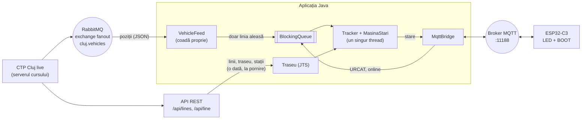
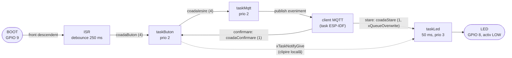

# Tema 04 – Tracker personal de autobuz

## 1. Ce face

Utilizatorul alege în aplicația Java **linia, sensul și stația** (din datele reale CTP Cluj) și cât îi ia să meargă pe jos până la stație. Aplicația urmărește autobuzele liniei în timp real, calculează când ajunge următorul în stație și îi spune plăcii ESP32-C3 **când trebuie să plece de acasă**; placa arată asta pe LED. Când urcă în autobuz, utilizatorul apasă **BOOT**, iar confirmarea ajunge în aplicația Java, care confirmă înapoi plăcii.

Tot calculul (distanța pe drum, viteza, ETA, starea) se face în Java; placa doar afișează starea și tratează butonul.

## 2. Arhitectura



- **Pozițiile** vin dintr-o coadă temporară proprie, legată de `cluj.vehicles` (`exchangeDeclare("cluj.vehicles", "fanout")`, nedurabil), nu din coada comună `ctp.cluj.vehicles`.
- **Callback-urile** RabbitMQ și MQTT rulează pe threadurile bibliotecilor; ele doar pun evenimente (`Vehicul`, `Urcat`, `PlacaOnline`) într-o `BlockingQueue`. Un singur thread le prelucrează, deci `Tracker` nu are nevoie de sincronizare.
- **Datele statice** (linii, traseu, stații) se citesc o dată. Codurile 401 și 404 opresc aplicația cu un mesaj clar; 502, 503 și erorile de rețea se reîncearcă cu backoff exponențial.
- **La oprire** (Ctrl+C), un shutdown hook închide canalul și conexiunea RabbitMQ și deconectează clientul MQTT.

## 3. Mesajele MQTT

Toate topic-urile sunt sub `ssatr/Pasca-Alex/tracker/`.

| Topic | Sens | QoS | Retained | Conținut |
|---|---|---|---|---|
| `…/stare` | Java → placă | 1 | da | starea curentă (mai jos) |
| `…/eveniment` | placă → Java | 1 | nu | `{"eveniment":"URCAT","ts":1764100123}` |
| `…/confirmare` | Java → placă | 1 | nu | `{"eveniment":"URCAT","ok":true}` |
| `…/online` | placă → broker | 1 | da | `1` la conectare; LWT `0` |

```json
{"stare":"PLEACA","eta_s":410,"rest_m":1650,"linie":"25","statie":"P-ța Mărăști","vehicul":"319","ts":1764100000}
```

- **`stare`:** una dintre `FARA_DATE`, `DEPARTE`, `PLEACA`, `GRABESTE_TE`, `IN_STATIE`, `CONFIRMAT`. `eta_s`, `rest_m` și `vehicul` lipsesc când nu e urmărit niciun autobuz.
- **Când se publică:** la fiecare schimbare de stare sau de autobuz și cel puțin o dată la 10 s (heartbeat).
- **`ts`:** epoch seconds UTC, ora reală a trimiterii (și în modul replay). Placa respinge o stare retained mai veche de 60 s, de exemplu una rămasă de la o rulare anterioară.
- **Dimensiune:** mesajele au sub 250 B și încap în bufferul plăcii. Dacă e nevoie, numele stației se scurtează.
- **`URCAT`:** placa trimite același `ts` la toate retrimiterile unei apăsări. Java confirmă fiecare retrimitere, dar o anunță în consolă o singură dată.

## 4. Taskurile de pe placă

| Task | Tip | Perioadă / prioritate | Rol |
|---|---|---|---|
| `taskLed` | periodic, `xTaskDelayUntil` | 50 ms, prioritate **3** (cea mai mare) | citește ultima stare din `coadaStare`, generează tiparul LED, watchdog de date |
| `taskButon` | sporadic, blocat pe `coadaButon` | prioritate 2 | la o apăsare: feedback local (notificare spre `taskLed`), construiește `URCAT`, îl pune în `coadaIesire`, așteaptă confirmarea 5 s, retrimite (max. 3 încercări) |
| `taskMqtt` | sporadic, blocat pe `coadaIesire` | prioritate 2 | singurul task al aplicației care publică evenimente |
| ISR buton | întrerupere pe front descendent, GPIO 9 | – | debounce de 250 ms (`xTaskGetTickCountFromISR`), apoi doar `xQueueSendFromISR` + `portYIELD_FROM_ISR` |
| task-ul clientului MQTT (ESP-IDF) | intern | – | conectare/reconectare, abonare la `stare` și `confirmare`, `online` + LWT; callback-ul parsează JSON-ul și scrie în cozi |



- **Fără variabile partajate:** taskurile comunică doar prin cozi și prin notificări. Singura excepție e starea conexiunii MQTT, un `std::atomic<bool>` scris de clientul MQTT și citit de `taskLed`.
- **`coadaStare` are lungimea 1** și se scrie cu `xQueueOverwrite`: contează doar ultima stare.
- **Clientul MQTT** e cel din ESP-IDF, inclus în core-ul Arduino, ca în temele 02 și 03, deci nu PubSubClient. Rulează în propriul task și se reconectează singur, așa că `taskMqtt` nu mai trebuie să facă `loop()`. Fișierele `connection.h` și `connection.cpp` pornesc de la cele din tema 03. Am adăugat: două abonări, mesaje de 256 B, `online` cu LWT, publicare retained și `mqtt_connected()`.

## 5. LED și buton

| Stare | Tipar LED | Ce înseamnă |
|---|---|---|
| pornire / conectare | clipire lentă, 0,5 Hz | încă nu a venit nicio stare |
| `FARA_DATE` | 2 clipiri scurte, pauză ~1,5 s | niciun autobuz valid sau fără conexiune |
| `DEPARTE` | stins | ai timp (rezervă > 3 min) |
| `PLEACA` | clipire rară, 1 Hz | e momentul să pleci (0 < rezervă ≤ 3 min) |
| `GRABESTE_TE` | clipire rapidă, 5 Hz | ai întârziat față de timpul de mers; grăbește-te |
| `IN_STATIE` | aprins continuu | autobuzul e la ≤ 80 m de stație |
| `CONFIRMAT` | 3 clipiri, pauză ~3 s, se repetă | ai confirmat că ai urcat |
| apăsare BOOT | 2 clipiri rapide, imediat | apăsarea a fost înregistrată (înainte de răspunsul Java) |

- **De ce `CONFIRMAT` se repetă:** specificația inițială cerea „3 clipiri, apoi stins”. Am ales repetarea pentru că, după o secundă, starea nu se mai deosebea de `DEPARTE`.
- **Watchdog de date:** dacă nu a venit nicio stare validă de 30 s sau MQTT e deconectat, LED-ul trece pe `FARA_DATE`, nu păstrează ultima stare, care poate fi învechită.

**Butonul BOOT** (apăsare scurtă) înseamnă „am urcat”:
1. Placa trimite `URCAT` pe `eveniment` și clipește de două ori.
2. Aplicația Java oprește urmărirea și răspunde pe `confirmare`, iar LED-ul trece pe `CONFIRMAT`.
3. Dacă nu vine confirmarea în 5 s, placa retrimite, de maximum 3 ori.

Apăsările făcute cât se așteaptă confirmarea sunt ignorate.

> **GPIO 9 e pin de strapping.** Dacă BOOT e ținut apăsat în momentul resetului, placa intră în modul de programare în loc să pornească schița. Apăsați BOOT doar după pornire.

## 6. Cum se calculează

**Distanța pe drum.**
- Traseul sensului (`shape`, puncte `[lat, lon]`) se proiectează într-un plan local în metri (echirectangular, centrat pe traseu) și devine un `LineString` JTS. Cu `LengthIndexedLine`, orice punct are o poziție *s* = metri de la începutul traseului, deci curbele contează.
- Stațiile se proiectează în ordinea parcurgerii, fiecare după cea dinainte. Astfel o stație de pe brațul de întoarcere nu ajunge pe brațul de dus.
- Un vehicul deja cunoscut se caută doar în fereastra [*s* − 200 m, *s* + 2000 m]. Se preferă poziția din față (un autobuz nu merge înapoi; la capăt de linie, același punct e și înainte, și după întoarcere), ca să nu sară pe alt braț în bucle sau pe tronsoane dus-întors.
- O poziție la peste 100 m de traseu e respinsă (depou, GPS eronat).
- Distanța rămasă e `s(stație) − s(vehicul)`. Sub −30 m, vehiculul a trecut de stație.

**ETA.**
- Viteza pe traseu se măsoară din progresul lui *s* între timestamp-urile vehiculului, nu din ceasul local, și se netezește exponențial cu constanta τ = 120 s, adică pe ultimele ~2 minute. Câmpul `speed` din sursă nu se folosește, pentru că unitatea lui nu e documentată.
- Netezirea pornește de la 5 m/s (18 km/h), viteza implicită, și e limitată la 1–15 m/s.
- Cât vehiculul stă pe loc (semafor, stație), viteza nu se actualizează. Durata opririi intră în următoarea măsurare, deci viteza nu cade la 0.
- `ETA = rest / viteză − vechimea poziției`.

**Ce vehicul se urmărește.** Un vehicul e candidat dacă:
- are `route_id`-ul liniei alese;
- merge pe sensul ales: `trip_id` egal cu sensul ales sau, dacă `trip_id` e `null`, *s* crește în ultimele 3 poziții;
- are poziția proaspătă (`age` ≤ 90 s, ultima poziție nu mai veche de 120 s) și nu a trecut de stație.

Mesajele duplicate (același `id` + `timestamp`) și cele mai vechi decât ultimul sunt ignorate. Un vehicul fără mesaje de 3 minute e scos. Se urmărește candidatul cu ETA minim. Autobuzul urmărit se schimbă doar dacă altul ajunge cu peste 30 s mai devreme, ca să nu oscileze.

**Starea** depinde de *rezervă* = ETA − timpul de mers pe jos:

| Stare | Condiție |
|---|---|
| `FARA_DATE` | niciun candidat de peste 60 s, sau RabbitMQ deconectat |
| `IN_STATIE` | rest ≤ 80 m |
| `GRABESTE_TE` | rezervă ≤ 0 |
| `PLEACA` | 0 < rezervă ≤ 180 s |
| `DEPARTE` | rezervă > 180 s |
| `CONFIRMAT` | după `URCAT`, definitiv |

O tranziție spre o stare mai urgentă se face la prag. Întoarcerea cere depășirea pragului cu o marjă de 30 s sau 30 m (histerezis), ca LED-ul să nu pâlpâie lângă prag. Pragurile se pot schimba din `config.properties`. Logica stărilor e în `MasinaStari`, o clasă pură, testată separat.

**Verificare pe date reale.** Pe o înregistrare de 9 minute (linia 25 spre Snagov Nord, stația P-ța Mărăști), autobuzul urmărit trece `PLEACA` → `GRABESTE_TE` → `IN_STATIE`, fără reveniri. ETA-ul calculat cu 3 minute înainte de sosire a greșit cu ~18 s.

## 7. Cum se rulează

### Secrete (nu se urcă în git)

```bash
cd aplicatie-java
cp config.example.properties config.properties   # completați api.key, rabbit.user, rabbit.pass
cd ../esp32_tracker
cp secrets.example.h secrets.h                     # completați rețeaua Wi-Fi (2.4 GHz)
```

`config.properties` și `secrets.h` sunt în `solutie/.gitignore`. Valorile din `config.properties` pot fi date și prin variabile de mediu, care au prioritate: `CHEIE_API`, `RABBIT_USER`, `RABBIT_PASS`.

### Aplicația Java (Java 17+, Maven)

```bash
cd aplicatie-java
mvn package                                         # rulează și testele JUnit
java -jar target/tracker-autobuz-1.0.jar            # meniu: linie/sens/stație sau destinație (secțiunea 8)
```

Pornire fără meniu, cu înregistrarea mesajelor brute:

```bash
java -jar target/tracker-autobuz-1.0.jar --route-id 14 --trip-id 14_0 --stop-id 169 --walk-min 5 --record inregistrari/azi.jsonl
```

În consolă apare o linie de stare la fiecare schimbare și o dată la 5 s, plus `[placa] ONLINE/OFFLINE` și confirmarea `URCAT`. Mesajele din consolă sunt fără diacritice, pentru că în consola Windows ar apărea ca `?`.

### Replay (fără RabbitMQ)

```bash
java -jar target/tracker-autobuz-1.0.jar --route-id 14 --trip-id 14_0 --stop-id 169 \
     --replay inregistrari/exemplu-linia25-10min.jsonl --speed 10
```

- Redă pozițiile înregistrate cu ritmul original împărțit la `--speed`, folosind un ceas virtual, ca vechimea pozițiilor și ETA să iasă ca la rularea live.
- API-ul REST e folosit în continuare, pentru linie și traseu.
- Stările se trimit plăcii, deci replay-ul funcționează și ca demo pe placă.
- În `inregistrari/` sunt două exemple, cu poziții publice: linia 25, ~100 s și ~9 minute.

### Placa (Arduino IDE sau arduino-cli)

- Core `esp32` 3.x, biblioteca **ArduinoJson** 7, placa **ESP32C3 Dev Module**.
- Pentru mesajele pe Serial prin USB: **USB CDC On Boot: Enabled**.

```bash
arduino-cli compile --fqbn esp32:esp32:esp32c3:CDCOnBoot=cdc --upload -p COM13 esp32_tracker
```

### Testarea plăcii fără aplicația Java

Cu Mosquitto. `ts` trebuie să fie ora curentă, altfel placa respinge starea ca veche:

```bash
T=ssatr/Pasca-Alex/tracker
for s in DEPARTE PLEACA GRABESTE_TE IN_STATIE CONFIRMAT FARA_DATE; do
  mosquitto_pub -h control.aut.utcluj.ro -p 11188 -q 1 -r -t $T/stare \
    -m "{\"stare\":\"$s\",\"ts\":$(date +%s)}"
  sleep 10
done
mosquitto_sub -h control.aut.utcluj.ro -p 11188 -v -t "$T/#"     # ce trimite placa (BOOT -> eveniment)
mosquitto_pub -h control.aut.utcluj.ro -p 11188 -q 1 -t $T/confirmare -m '{"eveniment":"URCAT","ok":true}'
```

Fără Mosquitto, același test se face cu Java, care folosește Paho din jar:

```bash
cd aplicatie-java
java -cp target/tracker-autobuz-1.0.jar unelte/TestLed.java                 # toate stările, câte 10 s
java -cp target/tracker-autobuz-1.0.jar unelte/TestLed.java CONFIRMAT       # doar stările date
```

După ultimul mesaj, placa trebuie să treacă singură pe `FARA_DATE` în ~30 s (watchdog-ul de date).

## 8. Extindere: locația utilizatorului și alegerea după destinație

La pornire, fără `--route-id`, aplicația întreabă cum alegi autobuzul:

1. **Linie, sens și stație**, ca mai sus. La timpul de mers poți răspunde `L`: timpul se calculează din locația ta și se actualizează cât te miști.
2. **Destinație.** Pornind de la locația ta, cauți stația unde vrei să ajungi, după nume:
   - aplicația găsește **liniile directe** (fără schimbare) care au o stație la cel mult 1 km de tine și, mai încolo pe același sens, o stație la cel mult 700 m de destinație;
   - ascultă **un minut** autobuzele reale ale acestor linii;
   - îți arată variantele ordonate după **ora de sosire**.

   Varianta aleasă e urmărită pe LED, la fel ca în modul clasic.

```
Varianta:
    1. linia 49 spre Disp. Unirii: urci la Biblioteca Judeteana (5 min pe jos), cobori la Iulius Mall Vest
       dupa 1.3 km; autobuzul vine in 7 min, ajungi la 23:06
    2. linia 25 spre Snagov Nord: urci la P-ta Marasti (2 min pe jos), cobori la Iulius Mall Vest
       dupa 1.6 km; autobuzul vine in 6 min, ajungi la 23:06
    3. linia 24B ...; autobuzul vine in 13 min, ajungi la 23:14
```

**De unde vine locația:**
- **`--de-la lat,lon`:** o locație fixă, bună pentru test și demo.
- **Pagina locală:** fără `--de-la`, aplicația pornește o pagină pe `http://localhost:8080` (portul se schimbă cu `locatie.port`) și o deschide în browser. Browserul cere permisiunea și trimite locația la fiecare schimbare. Pe pagină se pot introduce și coordonatele de mână. Serverul ascultă doar pe `127.0.0.1`, deci locația nu pleacă de pe calculator.

**Cum se calculează:**
- **Mersul pe jos:** distanța în linie dreaptă × 1,3 (străzile nu merg drept) / 1,4 m/s (~5 km/h).
- **Ora de sosire:** acum + ETA-ul primului autobuz **pe care îl poți prinde** (ajunge în stație după tine) + drumul pe traseu între cele două stații cu 5 m/s + mersul de la stația de coborâre.
- **Traseele tuturor liniilor** (~170) se citesc o singură dată și se păstrează în `cache-trasee.json`, ignorat de git, pentru 7 zile.

```bash
# demo fără RabbitMQ: lângă P-ța Mărăști; destinația se alege din meniu (2, apoi "iulius")
java -jar target/tracker-autobuz-1.0.jar --de-la 46.7770,23.6100 --replay inregistrari/exemplu-linia25-10min.jsonl --speed 10
```

### Harta „călătoria mea”

La pornire, aplicația deschide în browser `http://localhost:8080`, aceeași pagină care primește locația. Pagina arată:
- traseul liniei urmărite, cu stațiile;
- stația unde urci (verde) și, în modul destinație, stația unde cobori (mov);
- autobuzele liniei, actualizate la 2 s: cel urmărit pe LED e portocaliu, cele care vin spre stația ta sunt albastre, celelalte (alt sens, au trecut, sunt în afara traseului) sunt gri;
- locația ta și linia până la stație;
- un panou cu aceeași stare ca pe LED, plus ETA-ul, distanța rămasă, timpul tău de mers, cât mai ai până pleci și dacă placa e online.

În modul destinație, panoul afișează și variantele găsite.

Detalii tehnice:
- **Cum funcționează:** pagina citește `/traseu` și `/stare`, două JSON-uri construite de threadul tracker (`Harta.java`), și nu calculează nimic.
- **Dependențe externe:** harta folosește Leaflet (de pe unpkg, cu verificare SRI) și imagini OpenStreetMap, deci are nevoie de internet.
- **Port:** dacă portul e ocupat, aplicația merge mai departe fără hartă; portul se schimbă cu `locatie.port`.
- **Fără browser:** cu `--browser nu`, pagina nu se mai deschide automat.

**Limitări:**
- Fără rute cu schimbare de linie.
- Mersul pe jos e estimat, fără rutare pe străzi.
- Durata drumului cu autobuzul folosește viteza implicită, nu pe cea observată.
- Pe laptop, locația din browser vine din rețelele Wi-Fi din jur și poate avea o eroare de zeci sau sute de metri.
- Pe telefon, pagina ar cere HTTPS.

## 9. Limitări cunoscute

- **Nu există orare.** ETA-ul se bazează doar pe viteza observată. Primul autobuz văzut pornește de la viteza implicită de 5 m/s, până se adună câteva poziții (~1–2 minute).
- **Pe ultimele câteva sute de metri ETA-ul e optimist,** pentru că autobuzul încetinește la intrarea în stație. Starea `IN_STATIE` vine însă din distanță, nu din ETA.
- **Pozițiile sosesc cam la 20 s** și pot avea până la ~1 minut vechime. După pornire, imaginea flotei se adună în ~1 minut, iar până atunci starea e `FARA_DATE`.
- **Un vehicul fără `trip_id`** devine candidat abia după 3 poziții care avansează pe sensul ales, adică ~1 minut.
- **Vehiculele retrase nu sunt anunțate de sursă.** Dispar din calcul după 3 minute fără mesaje.
- **Proiecția echirectangulară** e precisă pentru distanțele dintr-un oraș (eroare sub 0,1 %).
- **Brokerul MQTT al cursului nu are autentificare,** deci oricine poate publica pe topic-urile noastre.

## 10. Ce s-a făcut: pași, fișiere, decizii, verificări

### Pașii, în ordine

| # | Ce s-a făcut | Cum s-a verificat |
|---|---|---|
| 1 | Analiza enunțului, a ghidului de integrare și a temelor 01–03 (setările MQTT, `connection.h` / `connection.cpp`) | brokerul `:11188` e fără autentificare; Paho 1.2.5 în Java; pe placă, clientul MQTT din ESP-IDF |
| 2 | Secretele: `solutie/.gitignore`, `config.example.properties`, `secrets.example.h` | `git check-ignore` pentru `config.properties` și `secrets.h` |
| 3 | Proiectul Maven, `CtpApiClient`, meniul linie / sens / stație | pe API-ul real: 168 de linii; o cheie greșită dă un mesaj clar pentru 401 |
| 4 | `Traseu` (JTS): distanța pe drum și continuitatea pe bucle | teste: curbă în L, dus-întors, zgomot GPS |
| 5 | `VehicleFeed` (RabbitMQ, coadă proprie pe `cluj.vehicles`), `--record` / `--replay` | live pe linia 25; replay-ul dă exact aceleași rezultate ca rularea live |
| 6 | `Tracker` + `MasinaStari`: filtrare, viteză netezită, ETA, stări cu histerezis | teste, plus reglaj pe o înregistrare reală de 9 minute (mai jos) |
| 7 | `MqttBridge`: stare retained + heartbeat, `URCAT` → confirmare | cap-coadă cu placa: BOOT → `URCAT` în Java → `CONFIRMAT` pe LED, din prima încercare |
| 8 | Schița ESP32: 3 taskuri, ISR cu debounce, cozi, watchdog | fiecare stare trimisă pe rând, verificată în jurnalul plăcii și pe LED; watchdog-ul trece singur pe `FARA_DATE` după 30 s |
| 9 | Test cap-coadă live, cu autobuze în circulație | rulat de utilizator, ziua (`--record inregistrari/test-live.jsonl`) |
| 10 | Acest README | – |
| 11 | Verificarea finală | `mvn clean package` verde; schița se compilează fără warning-uri (`--warnings all`); cheia API și parola RabbitMQ nu apar în niciun commit (căutare în tot istoricul) |
| + | Extinderi: locația utilizatorului, alegerea după destinație, harta „călătoria mea” (secțiunea 8) | teste + replay; harta, verificată prin capturi de ecran dintr-un Chrome headless |

### Fișierele soluției

| Fișier | Rol |
|---|---|
| `aplicatie-java/pom.xml` | Java 17; Jackson, amqp-client 5.21.0, Paho 1.2.5, JTS 1.20, JUnit 5; fat-jar cu maven-shade |
| `config.example.properties` | modelul de configurare; cel real, `config.properties`, e ignorat de git |
| `Main.java` | meniul, pornirea fără meniu (`--route-id` …), cele două moduri, bucla threadului tracker, shutdown hook |
| `Config.java` | configurarea din fișier și din variabile de mediu; pragurile stărilor |
| `CtpApiClient.java` | `/api/lines`, `/api/line`, toate traseele (cu `cache-trasee.json`); 401/404 fatale, 502/503 reîncercate cu backoff |
| `Meniu.java` | alegerea din liste, cu căutare fără diacritice; filtrul care scoate diacriticele din consolă |
| `Traseu.java` | proiecția în metri, `LengthIndexedLine`, fereastra de continuitate, stațiile în ordinea parcurgerii |
| `Vehicul.java` | parsarea tolerantă a mesajelor RabbitMQ |
| `VehicleFeed.java` | consumatorul RabbitMQ, înregistrarea și redarea |
| `CeasReplay.java` | ceasul virtual al replay-ului |
| `Tracker.java` | starea vehiculelor, candidații, viteza EMA, ETA, autobuzul urmărit, „primul autobuz pe care îl prinzi” |
| `MasinaStari.java` | stările cu histerezis (clasă pură) |
| `MqttBridge.java` | topic-urile `stare` / `eveniment` / `confirmare` / `online` |
| `Planificator.java` | variantele directe spre o destinație, distanța haversine, mersul pe jos |
| `ServerLocatie.java`, `resources/web/harta.html` | pagina locală: harta, locația din browser, `/traseu`, `/stare` |
| `Harta.java` | JSON-ul afișat de hartă |
| `unelte/TestLed.java` | trimite plăcii stări de test, fără aplicația principală |
| `inregistrari/*.jsonl` | înregistrări reale pentru replay (doar poziții publice) |
| `esp32_tracker/esp32_tracker.ino` | taskurile, ISR-ul, cozile, tiparele LED, watchdog-ul |
| `esp32_tracker/connection.*` | Wi-Fi, SNTP, MQTT (pornind de la tema 03, adaptat) |
| `esp32_tracker/config.h`, `secrets.example.h` | setări și pini; Wi-Fi-ul real e în `secrets.h`, ignorat de git |

### Decizii și abateri de la specificația inițială

- **Clientul MQTT de pe placă e cel din ESP-IDF, nu PubSubClient.** Așa erau temele 02–03. Rulează în propriul task și se reconectează singur, deci `taskMqtt` doar publică evenimentele.
- **`connection.cpp` a fost modificat**, deși în tema 03 era „gata făcut”: mesajele sunt de 256 B în loc de 64, sunt două abonări, `online` cu LWT, publicare retained.
- **Stațiile se proiectează în ordinea parcurgerii** și, pentru un vehicul cunoscut, se preferă poziția din față. Pe un traseu dus-întors, același punct e și „înainte de capăt”, și „după întoarcere”.
- **Viteza se netezește pe ~2 minute (τ = 120 s) și pornește de la 5 m/s.** Cu τ = 60 s și prima măsurare luată direct, ETA-ul pe date reale sărea 5:35 → 9:19 → 4:46, iar LED-ul ar fi oscilat. Cu reglajul: `PLEACA` → `GRABESTE_TE` → `IN_STATIE`, fără reveniri, iar ETA-ul de cu 3 minute înainte de sosire a greșit cu ~18 s.
- **`ts` din `stare` e ora reală și la replay,** altfel placa ar respinge stările ca vechi.
- **`CONFIRMAT` repetă 3 clipiri la ~4 s.** Varianta „3 clipiri, apoi stins” arăta după o secundă la fel ca `DEPARTE`.
- **Consola e fără diacritice,** pentru că în consola Windows apăreau ca `?`.
- **Locația, destinația și harta sunt extinderi** dincolo de enunț. Modul clasic a rămas neschimbat.

### Probleme găsite pe parcurs și rezolvate

| Problemă | Cauză | Rezolvare |
|---|---|---|
| „25” în lista de linii alegea al 25-lea element | numărul din listă și căutarea foloseau același câmp | listele lungi nu se afișează înainte de o căutare |
| după „Nimic găsit” nu se mai putea alege după număr | lista nu se reafișa | după o căutare fără rezultat, lista se afișează din nou |
| la capăt de linie, vehiculul „sărea înapoi” | proiecția alegea primul braț | preferință pentru poziția din față (test dedicat) |
| ETA și LED-ul oscilau pe date reale | netezire prea scurtă | τ = 120 s, pornire de la viteza implicită |
| `CONFIRMAT` nu se vedea | 0,6 s, lipit de LED-ul aprins de la `IN_STATIE` | clipiri precedate de pauză, repetate |
| `?` în loc de diacritice | consola Windows | filtru pe `System.out` / `System.err`; mesajele `Serial` fără diacritice |
| harta afișa o eroare de geolocație la `--de-la` | browserul refuza geolocația, deși locația era fixă | câmpul `locatie_fixa`; formularul se ascunde (`[hidden]` peste `display: flex`) |
| parola Wi-Fi pusă în `config.h`, urmărit de git | – | mutată în `secrets.h`, ignorat; `config.h` readus la versiunea din git |

### Testele JUnit (57, fără rețea)

| Clasă | Teste | Ce acoperă |
|---|---|---|
| `TrackerTest` | 16 | viteză din istoric, ETA cu vechimea, vehicul oprit, duplicate, sens opus, `trip_id` null, trecut de stație, schimbarea autobuzului cu histerezis, `FARA_DATE`, vehicul inactiv, `CONFIRMAT`, primul autobuz prins |
| `MasinaStariTest` | 7 | tranziții și histerezis pe toate pragurile |
| `TraseuTest` | 6 | curbă în L, dus-întors, ordinea stațiilor, zgomot GPS, distanța laterală, revenirea la proiecția globală |
| `MeniuTest` | 6 | căutare fără diacritice, liste lungi, linii cu același număr, filtrul de consolă |
| `MqttBridgeTest` | 4 | câmpurile mesajului, limita de 250 B, parsarea `URCAT` |
| `PlanificatorTest` | 4 | distanțe, variante directe, sens corect, ordonare |
| `ServerLocatieTest` | 4 | validarea locației, HTTP real: pagina, `/traseu`, `/stare`, `/locatie` |
| `VehiculTest` | 4 | câmpuri lipsă / `null` / `route_id` necunoscut, mesaje invalide |
| `CtpApiClientTest` | 3 | parsarea `/api/lines` și `/api/line` cu câmpuri lipsă |
| `HartaTest` | 3 | JSON-ul hărții |
